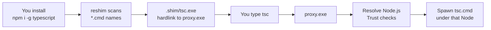

# Global Module Shims

In **shim** mode, a global CLI you install with npm (or yarn, pnpm, …) — for example `tsc`, `eslint`, or `prettier` — does not run straight from the active Node.js folder.
NVM for Windows places a hardlink (or copy) of **`proxy.exe`** on your `PATH` as `{DataRoot}/.shim/{name}.exe`.

You still type the same command.
The proxy picks the right Node.js version (same rules as the [node shim](/command/node)), checks that the install and the tool are trusted, then starts the real launcher under that version.

Package managers (`npm`, `npx`, `yarn`, `yarnpkg`, `pnpm`, `vlt`, `corepack`, and bun when the bun wrap is on) use the same `proxy.exe` binary — see [Package Manager Shims](/command/package-manager-shims).
The [node shim](/command/node) is a separate binary.

```powershell
npm install -g typescript
tsc --version
tsc --nvm-which --version
tsc --nvm-use=22 --version

yarn global add @vue/cli
vue --version
```

## How a global command is shimmed



Roughly:

1. **You install a global package** — for example `npm install -g typescript`.
2. **Reshim scans for launchers** — after the install (or a later proxy-triggered **reshim**), NVM collects `*.cmd` basenames under the active Node version directory.
3. **Extra scan locations**
   - **pnpm** — also `PNPM_HOME\bin` when set; a `pnpm` shim is always kept on PATH.
   - **Yarn Classic** (`yarn global`) — also `%LOCALAPPDATA%\Yarn\bin`. Yarn 2+ does not use `yarn global`.
4. **A shim is created for each name** — `{DataRoot}/.shim/{name}.exe` as a hardlink (or copy) of `{DataRoot}/proxy.exe`.
5. **You run the command** — `tsc` hits the proxy. The proxy then:
   - Handles `--nvm-use` and `--nvm-which` (stripped before the real tool). If the first argument is `--nvm-shim-version`, it prints the proxy version and exits.
   - Resolves the active Node.js version (preference, project detection, or `--nvm-use`).
   - **Directory safety (**NVM4305**)** — the Node directory must not be a reparse point and must not be writable by other users.
   - Finds `tsc.cmd` / `.exe` / `.bat` under that install (or under `%LOCALAPPDATA%\Yarn\bin` for Yarn Classic globals).
   - **Verifies trust** of itself, `node.exe`, and the delegated target, then **spawns** the real tool.

A short prewarm list (`node`, `npm`, `npx`, `yarn`, `pnpm`) is exercised after reshim. Other globals appear after install + reshim.

:::tip
`node` itself is a separate shim binary (not `proxy.exe`). Global CLIs and package managers share `proxy.exe`.
:::

## When reshim runs

`nvm reshim` refreshes the hardlinks (or copies) after:

- Node version installs or activation
- Global-affecting package-manager operations (for example `npm install -g`, yarn global/dlx/plugins, corepack enable/use)
- Explicit repair (`nvm doctor --autofix` / sync reshim)

If a new global CLI is missing from `PATH`, run reshim (or reinstall / activate the version) so `{DataRoot}/.shim/{name}.exe` is created.

## Integrity verification

If a trust check fails, the command does not run.

| Check | Behavior |
|-------|----------|
| Shim self-check | `{DataRoot}/.shim/{name}.exe` must match `{DataRoot}/proxy.exe` byte-for-byte |
| `node.exe` | Verify-cache / Authenticode (**NVM4301** / **NVM4303**) |
| Delegated `.cmd` / `.bat` / `.exe` | Script trust cache (SHA-256 + TPM-signed entry) or verify-cache for `.exe` — failure → **NVM4306** |
| Untrusted self-update | Entrypoint changed while the module is not trusted → **NVM4406** audit (deny / allow / prompt); see [NVM Firewall](/features/firewall) |

Trust entries are written at install, activation, and reshim.
If a global CLI self-update is blocked (**NVM4306**), run `nvm firewall trust module <name>`.
`nvm reshim` alone does not keep the module trusted after the next self-update.
Details: [Package Manager Shims — Integrity](/command/package-manager-shims#integrity-verification).

## Layout summary

```text
{DataRoot}/
├── proxy.exe              ← canonical package-manager / global shim
├── .shim/
│   ├── npm.exe            ← package managers (same binary)
│   ├── tsc.exe            ← example global CLI → proxy.exe
│   ├── eslint.exe
│   ├── <global-cli>.exe
│   └── node.exe           ← separate node shim binary
└── .verify/

{InstallRoot}/
└── vX.Y.Z/
    ├── tsc.cmd            ← real launcher under active Node
    └── node_modules/
        └── …
```

## Related

- [Package Manager Shims](/command/package-manager-shims)
- [node (shim)](/command/node)
- [Operating Modes](/features/modes)
- [NVM Firewall](/features/firewall) — trust after a global CLI self-updates
- [Error Codes](/troubleshooting/error-codes) — NVM4301, NVM4303, NVM4305, NVM4306, NVM4406
