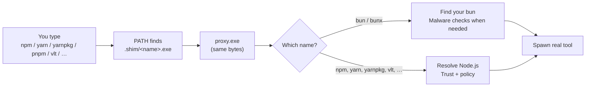

# Package Manager Shims

In **shim** mode, typing `npm`, `npx`, `yarn`, `yarnpkg`, `pnpm`, `vlt`, or `corepack` does not jump straight into the active Node.js folder.
NVM for Windows places hardlinks (or copies) of one Zig binary — **`proxy.exe`** — on your `PATH` under those names (and under `bun` / `bunx` when that wrap is on).

You still run the same commands you know.
The proxy picks the right Node.js version (same rules as the [node shim](/command/node)), checks that the install and the tool are trusted, then starts the real package manager under that version.

Global CLIs you install with those managers (for example `tsc`) use the same `proxy.exe` idea — see [Global Module Shims](/command/global-module-shims).

```powershell
npm --version
npm --nvm-which --version
npm --nvm-use=22 install
```

## How `proxy.exe` works

Every package-manager name under `{DataRoot}/.shim/` is a hardlink (or copy) of `{DataRoot}/proxy.exe`.
Windows runs that file under the name you typed (`npm.exe`, `yarn.exe`, …).
The proxy reads that name, then decides what to launch.



Roughly, the proxy:

1. **Sees how it was invoked** — basename from the process name (`npm`, `yarn`, `yarnpkg`, `bun`, …).
2. **Handles one-shot NVM flags** — `--nvm-use` and `--nvm-which` are stripped so they never reach the real tool. If the first argument is `--nvm-shim-version`, the proxy prints its version and exits (that flag is not stripped into the forwarded command line).
3. **Checks itself** — when started from `{DataRoot}/.shim/*.exe`, the file on disk must match `{DataRoot}/proxy.exe` byte-for-byte.
4. **Branches on the name**
   - **`bun` / `bunx`** — finds the bun you already installed, runs malware checks on package-manager-style commands, then spawns bun. It does not resolve Node.js.
   - **Everything else** — resolves Node.js (preference, project detection, or `--nvm-use`) and can auto-install when you have that configured.
5. **Directory safety (**NVM4305**)** — for Node-backed managers only, the active Node.js directory must not be a reparse point and must not be writable by other users. Failure → **NVM4305**. The bun / bunx path never reaches this check, so **NVM4305** does not apply to bun.
6. **Finds the real command** under that Node install (`.exe`, then `.cmd`, then `.bat`).
7. **Verifies trust** of `node.exe` and the delegated target before anything is spawned (see [Integrity verification](#integrity-verification)).
8. **Applies install-time policy** where it applies (cooldown, lifecycle-script block, Node security-flag inject), then **spawns** the real tool (for npm/npx/corepack often `node.exe` plus `*-cli.js`; otherwise the `.exe` or `.cmd`).

### Install-time policy

These controls run on the Node-backed path after trust succeeds:

| Control | Who it covers |
|---------|----------------|
| **[npm package minimum release age](/cfg/registry#governance-keys)** (cooldown) | **npm**, **npx**, **pnpm**, **yarn** / **yarnpkg**, **vlt**, and **bun** / **bunx** (when the bun wrap is on). Not corepack. |
| **[Block package manager lifecycle scripts](/cfg/registry#governance-keys)** | npm / npx / pnpm / yarn / yarnpkg / vlt (and corepack when it forwards an install). Forces `--ignore-scripts` or Yarn’s equivalent. |
| **Node security flags for lifecycle scripts** | **npm** / **npx** / **pnpm** only. Yarn, yarnpkg, bun, corepack, and **vlt** skip this inject. |
| **Advanced Logging (**NVM4412**)** | Certified Builds with Advanced Logging, for install-class commands. |

**Minimum release age:** Off by default on Community Builds. Certified Builds default to **2 days** when unset (including npx). Machine policy can force the value.

**Node security flags:** When [enforce permission model](/cfg/registry), [freeze V8 global objects](/cfg/registry), or [disallow eval/string code gen](/cfg/registry) is on, those flags are merged into npm’s Node options env for npm/npx/pnpm so lifecycle scripts inherit them. Off by default (no env write). The proxy does not set `NODE_OPTIONS`. Machine policy that forces the permission model also strips a caller `--permission-audit` from those env vars before spawn. A `--node-options=` you pass on the command line is left alone. `npm-cli.js` itself is not launched under `--permission`.

**vlt** is a first-class proxied command for module firewall argv (same shape as pnpm) and for global reshim when a `vlt` launcher exists. It is not an always-on default shim like yarn/pnpm/yarnpkg. The minimum-age cooldown maps to vlt’s publish cutoff (`VLT_BEFORE`).

**bun** / **bunx** get the same cooldown on install-class commands when the [bun wrap](#bun-malware-wrap) is on. The proxy passes Bun’s `--minimum-release-age` in seconds (policy minutes × 60). `bun test`, `bun run`, and other non-install commands skip the age inject.

`nvm reshim` refreshes the hardlinks (or copies) after installs, global package changes, and related events (also for [global module shims](/command/global-module-shims)).

## Supported package managers

| Command | Typical target | Notes |
|---------|----------------|-------|
| `npm` | `npm.cmd` / `node_modules/npm/bin/npm-cli.js` | From the active Node install |
| `npx` | `npx.cmd` / `node_modules/npm/bin/npx-cli.js` | From the active Node install |
| `pnpm` | `pnpm.cmd` / `.exe` (also `PNPM_HOME\bin`) | Always-on PATH shim; falls back to corepack when no launcher exists |
| `yarn` | `yarn.cmd` / `.exe` | Always-on PATH shim; same corepack fallback |
| `yarnpkg` | Same as yarn | Always-on PATH shim alongside yarn |
| `vlt` | `vlt.cmd` / `.exe` | Only when a vlt launcher is found; firewall argv like pnpm; minimum-age cooldown applies |
| `corepack` | `corepack` / `node_modules/corepack/dist/corepack.js` | When present in the Node install |
| `bun` / `bunx` | Your existing bun install | See [Bun malware wrap](#bun-malware-wrap); minimum-age cooldown on install-class commands when the wrap is on |

When `auto_install` is enabled, a missing auto-detected Node version prompts or installs the same way as `node` for these managers.

After global-affecting operations (for example `npm install -g`, yarn global/dlx/plugins, corepack enable/use), the proxy may trigger **reshim** so new [global CLI shims](/command/global-module-shims) appear. Yarn Classic writes those CLIs to `%LOCALAPPDATA%\Yarn\bin`. Yarn 2+ does not use `yarn global`.

## Bun malware wrap

NVM for Windows does not install bun and does not switch bun versions.
When [wrap bun for malware checks](/cfg/core#package-managers) is on, `reshim` puts `bun.exe` and `bunx.exe` on `PATH` as hardlinks (or copies) of `proxy.exe`.
The proxy finds the bun you already installed, then applies the same OpenSSF malware checks used for npm, pnpm, and yarn.

Find order:

1. `%BUN_INSTALL%\bin\bun.exe` (or `bunx.exe`)
2. `%USERPROFILE%\.bun\bin\bun.exe`
3. `PATH`, skipping `{DataRoot}/.shim`

Malware checks run for `bun install` / `i` / `add` / `x` / `create` / `update` and for every `bunx` invocation.
Those same install-class commands also get the [minimum-age cooldown](/cfg/registry#governance-keys) as Bun’s `--minimum-release-age` (seconds).
`bun test`, `bun run`, and other bun commands pass through with no package scan and no age inject.
Bun never runs the Node directory safety check, so it cannot raise **NVM4305**.

Turn the wrap off to remove the extra `CreateProcessW` hop:

```powershell
nvm config set shim_bun=false
nvm reshim
```

Defaults: **off** in Community builds. **On** in Certified Builds. Machine policy wins over your user setting. See [`shim_bun`](/cfg/core#package-managers).

## Integrity verification

If a trust check fails, the command does not run.

### Shim binary

| Subject | Check |
|---------|--------|
| `{DataRoot}/.shim/{name}.exe` | Contents must match `{DataRoot}/proxy.exe` |
| `{DataRoot}/.shim/node.exe` | Contents must match the program-root canonical node shim |

Mismatch → `shim integrity check failed`, exit `1`.

### Resolved `node.exe`

Same verify-cache / Authenticode path as the [node shim](/command/node).
Cache state changes can surface as **NVM4303**; untrusted Node → **NVM4301**; FileVersion mismatch → **NVM4314**; Certified version firewall → **NVM4411**.

### Delegated package-manager targets

| Target type | Verification |
|-------------|--------------|
| npm / npx / corepack JS entry (`npm-cli.js`, `npx-cli.js`, `corepack.js`) | SHA-256 + TPM-signed **script trust** cache entry |
| Delegated `.exe` | Same verify-cache path used for `node.exe` |
| Delegated `.cmd` / `.bat` | SHA-256 + TPM-signed script trust cache entry |

Trust entries are written when versions are installed, activated, or reshimed.
If a script changed since it was trusted, or no trust entry exists, launch is blocked (**NVM4306**).
If you trust the change, run `nvm firewall trust module <name>`.
`nvm reshim` alone does not keep the module trusted after the next self-update.
You can also reinstall the version or run `nvm doctor --autofix` as appropriate.

:::warning
`node.exe` trust alone is not enough for package managers. Entrypoint scripts must also match the script trust cache (SEC-04).
:::

## Layout summary

```text
{DataRoot}/
├── proxy.exe              ← canonical package-manager / global shim
├── .shim/
│   ├── npm.exe            ← hardlink (or copy) of proxy.exe
│   ├── npx.exe
│   ├── yarn.exe           ← always-on default
│   ├── yarnpkg.exe        ← always-on default
│   ├── pnpm.exe           ← always-on default
│   ├── vlt.exe            ← only when a vlt launcher is present
│   ├── bun.exe            ← when bun wrap is on
│   ├── bunx.exe
│   ├── <global-cli>.exe   ← see Global Module Shims
│   └── node.exe           ← separate node shim binary
└── .verify/               ← verify-cache public key material

{InstallRoot}/
└── vX.Y.Z/
    ├── node.exe           ← real OpenJS Node.js
    ├── npm.cmd
    ├── npx.cmd
    └── node_modules/
        └── …
```

## Related

- [Global Module Shims](/command/global-module-shims)
- [node (shim)](/command/node)
- [Operating Modes](/features/modes)
- [`nvm use shim`](/command/nvm/use/shim)
- [Registry Policy Reference](/cfg/registry) — human labels and value names for the policies above
- [Error Codes](/troubleshooting/error-codes) — NVM4301, NVM4303, NVM4305, NVM4306, NVM4314, NVM4411, NVM4412
