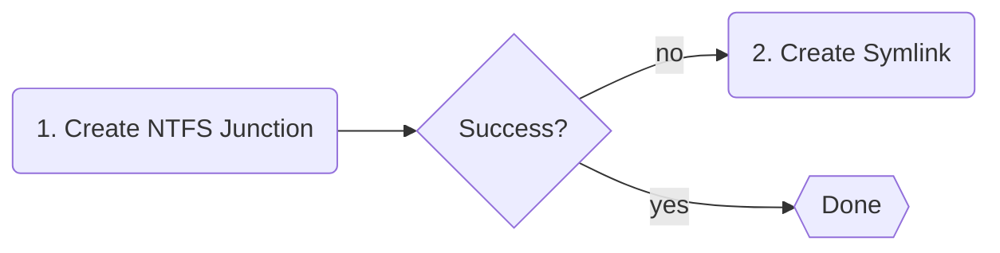

import SymlinkPermissionExplainer from '../_components/SymlinkPermissionExplainer.mdx';

# Operating Modes

NVM for Windows operates in one of two modes: link or shim. These modes determine how Node.js, dependency managers, and global modules are executed. The operating mode can be switched at any time.

```powershell title="Setting the Operational Mode"
# Easy access
nvm use shim
nvm use link

# Also available in the nvm configuration
nvm cfg set mode=shim
nvm cfg set mode=link
```

## Link Mode \{#link-mode\}

This mode uses links to locate the active system-wide version of `node.exe`. The link is part of the `PATH`. Running [`nvm use`](../command/nvm/use) changes the _target_ of the link path, not the path itself. `PATH` never changes.

Link mode offers an experience that is as close as possible to simply running `node.exe` "as delivered" by [nodejs.org](https://nodejs.org). It offers zero latency, but does not provide the advanced modern workflow features available in Shim Mode.

Version 2.0.0 introduced the "fallback" link creation strategy.



<SymlinkPermissionExplainer/>

:::warning
NVM for Windows v2 will not attempt to elevate permissions (i.e. no UAC prompt) on failure of symlink creation. If permissions block the creation of a link, a native desktop notification warns users and offers guidance.
:::

## Activation links and OpenSSH \{#activation-symlinks\}

`PATH` always contains the `.nodejs` activation entry. By default, NVM for Windows creates that entry as an NTFS junction (shim mode: `.nodejs` → `.shim`; link mode: `.nodejs` → `.link\nodejs`, and `.link\nodejs` → the active version).

Windows OpenSSH can enable Redirection Guard on `sshd`. That mitigation blocks traversal of junctions that a non-administrator created. Local terminals still work. SSH sessions may report that `.nodejs` is an untrusted mount point and fail to find `node`.

**Certified Builds** can set machine policy `RequireActivationSymlinks` (registry `RequireActivationSymlinks`). When enabled, activation links are created as symbolic links only. Pair the policy with Developer Mode or `SeCreateSymbolicLinkPrivilege` from Group Policy so creation does not fail. After you enable the policy, the next `nvm on`, mode switch, profile init, or link-mode `nvm use` recreates existing junctions as symlinks.

Community Builds keep the default junction-first behavior unless an administrator sets the same registry value manually.

## Shim Mode (default) \{#shim-mode-default\}

Shim mode offers a new, streamlined developer experience. When compared with Link Mode, Shim Mode comes with the benefit of avoiding esoteric permission requirements, but at the cost of a small amount of additional latency (~25-35ms total). This latency is negligible for most use cases. For this reason, Shim Mode is recommended for most users.

Most users won't notice or feel the impact of shim latency, making shim mode recommended for most users.

Shim executables under `.shim` are hard links to `proxy.exe`. Hard links require the **same volume** for Node storage (`root` / InstallRoot) and the NVM data directory that holds `.shim`. If the hard link cannot be created (for example, Node on `D:` and NVM on `C:`), NVM tries a **file symlink** instead. That fallback needs [Developer Mode](https://learn.microsoft.com/en-us/windows/apps/get-started/enable-your-device-for-development) or `SeCreateSymbolicLinkPrivilege` (same requirements as [link mode](#link-mode) UNC symlinks). If both fail, `nvm install` / `nvm reshim` fail and roll back rather than leaving a broken `npm`/`npx` PATH. Keep `root` on the same drive as NVM, switch to link mode, or enable Developer Mode.

Shim mode features:

- Auto-use pinned versions via `.nvmrc`, `.node-version`, `package.json`, or other custom runtime config files.
- Auto-install missing versions on `nvm use`. (Optional)
- Unified package manager mismatch handling.
- Lockdown Node.js/V8 permissions. (Optional) _Requires Certified Builds with the Governance add-on._
- Publisher trust: Verifies node.exe publisher to prevent untrusted node.exe swaps.
- Native event logging.
- Unified/configurable cooldown periods across all major package managers (npm/npx/yarn/pnpm/vlt/bun). Community Builds default to off. Certified Builds default to 2 days. Users can change either. Forcing the value from machine policy requires the Governance add-on.

:::tip[Certified Builds]
Shim **V8 / permission lockdown** (`EnforcePermissionModel`, `FreezeV8GlobalObjects`, `DisableEvalAndStringExecution`) is a Governance feature. Package-manager **cooldown** is not. Governance can force the cooldown from machine policy. See [registry policy](../cfg/registry) and [Choosing a Build](../guide/builds/).
:::

:::info
Windows has a "universal latency tax". It uses [`CreateProcessW`](https://learn.microsoft.com/en-us/windows/win32/api/processthreadsapi/nf-processthreadsapi-createprocessw) to launch _any_ executable. This tax is paid when the shim is launched and again when the shim runs `node.exe`. On average, `CreateProcessW` takes 15ms. The shim adds 1-3ms to identify the desired Node.js version and securely relay the command.

`15ms (shim CreateProcessW) + 3ms (shim logic) + 15ms (shim CreateProcessW) = 33ms`
:::

## Comparison

||Link|Shim|
|:-|:-:|:-:|
|Latency[^1]|0ms|25-35ms|
|System Version|:heavy_check_mark:|:heavy_check_mark:|
|Automatic Installation (`nvm use --install`)|:heavy_check_mark:|:heavy_check_mark:|
|Automatic version detection|:x:|:heavy_check_mark:|
|Auto-install missing detected version|:x:|:heavy_check_mark:|
|One-shot version override (`--nvm-use`)|:x:|:heavy_check_mark:|
|Signed / verified package manager shims|:x:|:heavy_check_mark:|
|Signed /verified module shims|:x:|:heavy_check_mark:|
|Per-launch `node.exe` publisher trust|:x:|:heavy_check_mark:|
|Malicious package blocking|:x:|:heavy_check_mark:|
|Module and trust firewall|:x:|:heavy_check_mark:|
|Package manager mismatch handling|:x:|:heavy_check_mark:|
|Node.js / V8 permission lockdown|:x:|:heavy_check_mark:<br/>_Governance_|
|Package manager cooldown|:x:|:heavy_check_mark:|
|Per-command execution logging|:x:|:heavy_check_mark:|
|Special Permissions<br/><br/>|[`SeCreateSymbolicLinkPrivilege`](https://learn.microsoft.com/en-us/previous-versions/windows/it-pro/windows-10/security/threat-protection/security-policy-settings/create-symbolic-links)<br/>_for [UNC path](https://learn.microsoft.com/en-us/dotnet/standard/io/file-path-formats#unc-paths) symlinks_|None for same-volume hardlinks; symlink privilege / Developer Mode only if `.shim` and `proxy.exe` are on different volumes<br/><br/>|


[^1]: Latency is predominantly from Windows `CreateProcessW` universal latency tax. The shim executable only adds ~1-3ms latency.
