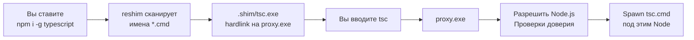

# Global Module Shims

В режиме **shim** глобальный CLI, который вы ставите через npm (или yarn, pnpm, …) — например `tsc`, `eslint` или `prettier` — не запускается прямо из каталога активной версии Node.js.
NVM for Windows ставит в ваш `PATH` hardlink (или копию) **`proxy.exe`** как `{DataRoot}/.shim/{name}.exe`.

Вы по-прежнему вводите ту же команду.
Proxy выбирает нужную версию Node.js (те же правила, что у [node shim](/command/node)), проверяет доверие к установке и инструменту, затем стартует реальный launcher под этой версией.

Менеджеры пакетов (`npm`, `npx`, `yarn`, `yarnpkg`, `pnpm`, `vlt`, `corepack` и bun, если обёртка bun включена) используют тот же бинарник `proxy.exe` — см. [Package Manager Shims](/command/package-manager-shims).
[node shim](/command/node) — отдельный бинарник.

```powershell
npm install -g typescript
tsc --version
tsc --nvm-which --version
tsc --nvm-use=22 --version

yarn global add @vue/cli
vue --version
```

## Как шимится глобальная команда \{#how-a-global-command-is-shimmed\}



В общих чертах:

1. **Вы устанавливаете глобальный пакет** — например `npm install -g typescript`.
2. **Reshim сканирует launchers** — после установки (или позже proxy-triggered **reshim**) NVM собирает basenames `*.cmd` в каталоге активной версии Node.
3. **Дополнительные места сканирования**
   - **pnpm** — также `PNPM_HOME\bin`, если задан; shim `pnpm` всегда держится на PATH.
   - **Yarn Classic** (`yarn global`) — также `%LOCALAPPDATA%\Yarn\bin`. Yarn 2+ не использует `yarn global`.
4. **Для каждого имени создаётся shim** — `{DataRoot}/.shim/{name}.exe` как hardlink (или копия) `{DataRoot}/proxy.exe`.
5. **Вы запускаете команду** — `tsc` попадает в proxy. Дальше proxy:
   - Обрабатывает `--nvm-use` и `--nvm-which` (снимаются до реального инструмента). Если первый аргумент — `--nvm-shim-version`, печатает версию proxy и завершает работу.
   - Разрешает активную версию Node.js (preference, detection проекта или `--nvm-use`).
   - **Безопасность каталога (**NVM4305**)** — каталог Node не должен быть reparse point и не должен быть writable другими пользователями.
   - Находит `tsc.cmd` / `.exe` / `.bat` в этой установке (или в `%LOCALAPPDATA%\Yarn\bin` для globals Yarn Classic).
   - **Проверяет доверие** к себе, `node.exe` и делегированной цели, затем **запускает** реальный инструмент.

Короткий prewarm-список (`node`, `npm`, `npx`, `yarn`, `pnpm`) прогоняется после reshim. Остальные globals появляются после install + reshim.

:::tip
Сам `node` — отдельный бинарник shim (не `proxy.exe`). Глобальные CLI и менеджеры пакетов делят `proxy.exe`.
:::

## Когда выполняется reshim \{#when-reshim-runs\}

`nvm reshim` обновляет hardlink (или копии) после:

- Установки или активации версии Node
- Операций менеджеров пакетов, затрагивающих globals (например `npm install -g`, yarn global/dlx/plugins, corepack enable/use)
- Явного ремонта (`nvm doctor --autofix` / sync reshim)

Если новый глобальный CLI отсутствует в `PATH`, выполните reshim (или переустановите / активируйте версию), чтобы создать `{DataRoot}/.shim/{name}.exe`.

## Проверка целостности \{#integrity-verification\}

Если проверка доверия не проходит, команда не запускается.

| Проверка | Поведение |
|----------|-----------|
| Self-check shim | `{DataRoot}/.shim/{name}.exe` должен побайтно совпадать с `{DataRoot}/proxy.exe` |
| `node.exe` | Verify-cache / Authenticode (**NVM4301** / **NVM4303**) |
| Делегированный `.cmd` / `.bat` / `.exe` | Script trust cache (SHA-256 + TPM-подпись) или verify-cache для `.exe` — отказ → **NVM4306** |
| Недоверенный self-update | Entrypoint изменился, пока модуль не доверен → аудит **NVM4406** (deny / allow / prompt); см. [NVM Firewall](/features/firewall) |

Записи доверия пишутся при install, activation и reshim.
Если self-update global CLI блокируется (**NVM4306**), выполните `nvm firewall trust module <name>`.
Одного `nvm reshim` недостаточно, чтобы модуль оставался доверенным после следующего self-update.
Подробнее: [Package Manager Shims — Integrity](/command/package-manager-shims#integrity-verification).

## Схема размещения \{#layout-summary\}

```text
{DataRoot}/
├── proxy.exe              ← канонический shim менеджеров / globals
├── .shim/
│   ├── npm.exe            ← менеджеры пакетов (тот же бинарник)
│   ├── tsc.exe            ← пример глобального CLI → proxy.exe
│   ├── eslint.exe
│   ├── <global-cli>.exe
│   └── node.exe           ← отдельный node shim
└── .verify/

{InstallRoot}/
└── vX.Y.Z/
    ├── tsc.cmd            ← реальный launcher в активном Node
    └── node_modules/
        └── …
```

## См. также \{#related\}

- [Package Manager Shims](/command/package-manager-shims)
- [node (shim)](/command/node)
- [Режимы работы](/features/modes)
- [NVM Firewall](/features/firewall) — доверие после self-update глобального CLI
- [Коды ошибок](/troubleshooting/error-codes) — NVM4301, NVM4303, NVM4305, NVM4306, NVM4406
