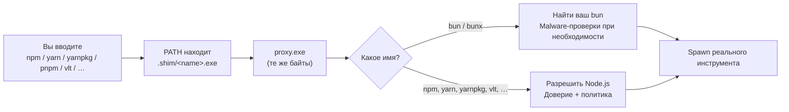

# Package Manager Shims

В режиме **shim** команды `npm`, `npx`, `yarn`, `yarnpkg`, `pnpm`, `vlt` или `corepack` не прыгают сразу в каталог активной версии Node.js.
NVM for Windows ставит в ваш `PATH` hardlink (или копии) одного Zig-бинарника — **`proxy.exe`** — под этими именами (и под `bun` / `bunx`, если обёртка включена).

Вы по-прежнему запускаете привычные команды.
Proxy выбирает нужную версию Node.js (те же правила, что у [node shim](/command/node)), проверяет доверие к установке и инструменту, затем стартует настоящий package manager под этой версией.

Глобальные CLI, которые вы ставите этими менеджерами (например `tsc`), используют ту же идею `proxy.exe` — см. [Global Module Shims](/command/global-module-shims).

```powershell
npm --version
npm --nvm-which --version
npm --nvm-use=22 install
```

## Как работает `proxy.exe` \{#how-proxyexe-works\}

Каждое имя package manager под `{DataRoot}/.shim/` — hardlink (или копия) `{DataRoot}/proxy.exe`.
Windows запускает этот файл под тем именем, которое вы набрали (`npm.exe`, `yarn.exe`, …).
Proxy читает это имя и решает, что запустить.



В общих чертах proxy:

1. **Видит, как его вызвали** — basename из имени процесса (`npm`, `yarn`, `yarnpkg`, `bun`, …).
2. **Обрабатывает одноразовые флаги NVM** — `--nvm-use` и `--nvm-which` снимаются и не доходят до реального инструмента. Если первый аргумент — `--nvm-shim-version`, proxy печатает свою версию и завершает работу (этот флаг не попадает в forwarded argv).
3. **Проверяет себя** — при старте из `{DataRoot}/.shim/*.exe` файл на диске должен побайтно совпадать с `{DataRoot}/proxy.exe`.
4. **Ветвится по имени**
   - **`bun` / `bunx`** — находит уже установленный bun, при package-manager-командах гоняет malware-проверки, затем spawn bun. Node.js не разрешает.
   - **Остальные** — разрешает Node.js (preference, detection проекта или `--nvm-use`) и может автоустановить, если так настроено.
5. **Безопасность каталога (**NVM4305**)** — только для менеджеров на Node: каталог активной версии Node.js не должен быть reparse point и не должен быть writable другими пользователями. Отказ → **NVM4305**. Путь bun / bunx до этой проверки не доходит, поэтому **NVM4305** к bun не применяется.
6. **Находит реальную команду** в этой установке Node (`.exe`, затем `.cmd`, затем `.bat`).
7. **Проверяет доверие** к `node.exe` и делегированной цели до любого spawn (см. [Проверка целостности](#integrity-verification)).
8. **Применяет политику установки**, где она действует (cooldown, блок lifecycle-скриптов, inject флагов безопасности Node), затем **запускает** реальный инструмент (для npm/npx/corepack часто `node.exe` плюс `*-cli.js`; иначе `.exe` или `.cmd`).

### Политика установки \{#install-time-policy\}

Эти контроли идут по пути Node после успешной проверки доверия:

| Контроль | Кого покрывает |
|---------|----------------|
| **[Минимальный возраст публикации npm-пакета](/cfg/registry#governance-keys)** (cooldown) | **npm**, **npx**, **pnpm**, **yarn** / **yarnpkg**, **vlt** и **bun** / **bunx** (если обёртка bun включена). Не corepack. |
| **[Блокировать lifecycle-скрипты package manager](/cfg/registry#governance-keys)** | npm / npx / pnpm / yarn / yarnpkg / vlt (и corepack, когда он проксирует install). Принудительно `--ignore-scripts` или аналог Yarn. |
| **Флаги безопасности Node для lifecycle-скриптов** | Только **npm** / **npx** / **pnpm**. Yarn, yarnpkg, bun, corepack и **vlt** пропускают inject. |
| **Advanced Logging (**NVM4412**)** | Certified Builds с Advanced Logging, для install-команд. |

**Минимальный возраст:** в Community по умолчанию выкл. В Certified Builds по умолчанию **2 дня**, если не задано (включая npx). Машинная политика может форсировать значение.

**Флаги безопасности Node:** если включены [enforce permission model](/cfg/registry), [freeze V8 global objects](/cfg/registry) или [disallow eval/string code gen](/cfg/registry), эти флаги мержатся в env опций Node для npm у npm/npx/pnpm, чтобы lifecycle-скрипты их наследовали. По умолчанию выкл. (env не пишется). Proxy не задаёт `NODE_OPTIONS`. Машинная политика, форсирующая permission model, также убирает вызывающий `--permission-audit` из этих env перед spawn. `--node-options=` в командной строке не трогает. Сам `npm-cli.js` не запускается под `--permission`.

**vlt** — первоклассная proxied-команда для module firewall argv (как pnpm) и для global reshim, когда найден launcher `vlt`. Это не always-on shim вроде yarn/pnpm/yarnpkg. Cooldown минимального возраста мапится на cutoff публикации vlt (`VLT_BEFORE`).

**bun** / **bunx** получают тот же cooldown на install-командах, когда включена [обёртка bun](#bun-malware-wrap). Proxy передаёт Bun `--minimum-release-age` в секундах (минуты политики × 60). `bun test`, `bun run` и остальные non-install команды пропускают inject возраста.

`nvm reshim` обновляет hardlink (или копии) после установок, изменений глобальных пакетов и связанных событий (также для [shim глобальных модулей](/command/global-module-shims)).

## Поддерживаемые менеджеры пакетов \{#supported-package-managers\}

| Команда | Типичная цель | Заметки |
|---------|----------------|---------|
| `npm` | `npm.cmd` / `node_modules/npm/bin/npm-cli.js` | Из активной установки Node |
| `npx` | `npx.cmd` / `node_modules/npm/bin/npx-cli.js` | Из активной установки Node |
| `pnpm` | `pnpm.cmd` / `.exe` (также `PNPM_HOME\bin`) | Always-on shim на PATH; fallback на corepack, если launcher нет |
| `yarn` | `yarn.cmd` / `.exe` | Always-on shim на PATH; тот же fallback на corepack |
| `yarnpkg` | Как у yarn | Always-on shim рядом с yarn |
| `vlt` | `vlt.cmd` / `.exe` | Только когда найден launcher vlt; firewall argv как у pnpm; действует cooldown минимального возраста |
| `corepack` | `corepack` / `node_modules/corepack/dist/corepack.js` | Если есть в установке Node |
| `bun` / `bunx` | Уже установленный bun | См. [обёртка bun](#bun-malware-wrap); cooldown минимального возраста на install-командах при включённой обёртке |

При включённом `auto_install` отсутствующая auto-detected версия Node предлагается или ставится так же, как для `node`.

После операций, затрагивающих globals (например `npm install -g`, yarn global/dlx/plugins, corepack enable/use), proxy может вызвать **reshim**, чтобы появились новые [shim глобальных CLI](/command/global-module-shims). Yarn Classic пишет эти CLI в `%LOCALAPPDATA%\Yarn\bin`. Yarn 2+ не использует `yarn global`.

## Обёртка bun \{#bun-malware-wrap\}

NVM for Windows не устанавливает bun и не переключает версии bun.
Если включена [обёртка bun для malware-проверок](/cfg/core#package-managers), `reshim` ставит `bun.exe` и `bunx.exe` в `PATH` как hardlink (или копии) `proxy.exe`.
Proxy находит уже установленный bun и применяет те же проверки OpenSSF malware, что для npm, pnpm и yarn.

Порядок поиска:

1. `%BUN_INSTALL%\bin\bun.exe` (или `bunx.exe`)
2. `%USERPROFILE%\.bun\bin\bun.exe`
3. `PATH`, пропуская `{DataRoot}/.shim`

Проверки malware идут для `bun install` / `i` / `add` / `x` / `create` / `update` и для каждого вызова `bunx`.
Те же install-команды также получают [cooldown минимального возраста](/cfg/registry#governance-keys) как Bun `--minimum-release-age` (секунды).
`bun test`, `bun run` и остальные команды bun проходят без сканирования пакетов и без inject возраста.
Bun не выполняет проверку безопасности каталога Node, поэтому **NVM4305** для bun не возникает.

```powershell
nvm config set shim_bun=false
nvm reshim
```

По умолчанию: **выкл** в Community, **вкл** в Certified Builds. Машинная политика важнее пользовательской настройки. См. [`shim_bun`](/cfg/core#package-managers).

## Проверка целостности \{#integrity-verification\}

Если проверка доверия не проходит, команда не запускается.

### Бинарник shim \{#shim-binary\}

| Объект | Проверка |
|--------|----------|
| `{DataRoot}/.shim/{name}.exe` | Содержимое должно совпадать с `{DataRoot}/proxy.exe` |
| `{DataRoot}/.shim/node.exe` | Содержимое должно совпадать с каноническим node shim в program-root |

Несовпадение → `shim integrity check failed`, код `1`.

### Разрешённый `node.exe` \{#resolved-nodeexe\}

Тот же путь verify-cache / Authenticode, что у [node shim](/command/node).
Смена состояния кэша может дать **NVM4303**; недоверенный Node → **NVM4301**; несовпадение FileVersion → **NVM4314**; Certified version firewall → **NVM4411**.

### Делегированные цели package manager \{#delegated-package-manager-targets\}

| Тип цели | Проверка |
|----------|----------|
| JS entry npm / npx / corepack (`npm-cli.js`, `npx-cli.js`, `corepack.js`) | SHA-256 + TPM-подписанная запись **script trust** cache |
| Делегированный `.exe` | Тот же verify-cache путь, что для `node.exe` |
| Делегированный `.cmd` / `.bat` | SHA-256 + TPM-подписанная запись script trust cache |

Записи доверия пишутся при установке/активации версий или reshim.
Если скрипт изменился с момента доверия или записи нет — запуск блокируется (**NVM4306**).
Если вы доверяете изменению, выполните `nvm firewall trust module <name>`.
Одного `nvm reshim` недостаточно, чтобы модуль оставался доверенным после следующего self-update.
Также можно переустановить версию или выполнить `nvm doctor --autofix`.

:::warning
Одного доверия к `node.exe` недостаточно для менеджеров пакетов. Entrypoint-скрипты тоже должны совпадать со script trust cache (SEC-04).
:::

## Схема размещения \{#layout-summary\}

```text
{DataRoot}/
├── proxy.exe              ← канонический shim менеджеров / globals
├── .shim/
│   ├── npm.exe            ← hardlink (или копия) proxy.exe
│   ├── npx.exe
│   ├── yarn.exe           ← always-on по умолчанию
│   ├── yarnpkg.exe        ← always-on по умолчанию
│   ├── pnpm.exe           ← always-on по умолчанию
│   ├── vlt.exe            ← только когда найден launcher vlt
│   ├── bun.exe            ← если обёртка bun включена
│   ├── bunx.exe
│   ├── <global-cli>.exe   ← см. Global Module Shims
│   └── node.exe           ← отдельный node shim
└── .verify/               ← материал публичного ключа verify-cache

{InstallRoot}/
└── vX.Y.Z/
    ├── node.exe           ← настоящий OpenJS Node.js
    ├── npm.cmd
    ├── npx.cmd
    └── node_modules/
        └── …
```

## См. также \{#related\}

- [Global Module Shims](/command/global-module-shims)
- [node (shim)](/command/node)
- [Режимы работы](/features/modes)
- [`nvm use shim`](/command/nvm/use/shim)
- [Справочник политики реестра](/cfg/registry) — человекочитаемые имена и value names для политик выше
- [Коды ошибок](/troubleshooting/error-codes) — NVM4301, NVM4303, NVM4305, NVM4306, NVM4314, NVM4411, NVM4412
